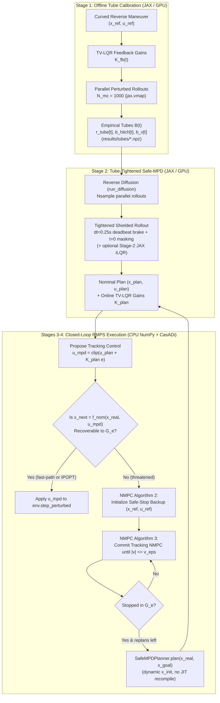

# Robust Model Predictive Shielding (RMPS) in Safe-MPD

This document explains at a high level how **Robust Model Predictive Shielding (RMPS)** is integrated with **Safe Model Predictive Diffusion (Safe-MPD)** in this repository for the 6D acceleration-controlled tractor-trailer (`AccTractorTrailer2d`).

For script-by-script API details, see [docs/README.md](README.md). For CLI commands and every configurable parameter, see [docs/TESTING_AND_BENCHMARKING.md](TESTING_AND_BENCHMARKING.md).

---

## 1. Motivation: Why Nominal Safe-MPD Needs Robust Shielding

Nominal **Safe-MPD** (`mbd/planners/mbd_planner.py`) synthesizes kinodynamically feasible, collision- and jackknife-free trajectories on a **nominal** vehicle model by enforcing safety during every reverse denoising rollout (`shielded_rollout`).

However, when the resulting nominal control sequence is executed open-loop in a perturbed environment (`env.step_perturbed`), three failure modes arise:

1. **Level 1 — Gaussian Control Noise** (`control_noise_std`): Small actuation errors accumulate over a 50-step ($12.5\,\text{s}$) horizon, pushing the tractor or trailer off the nominal path into nearby obstacles.
2. **Level 2 — Model Parameter Uncertainty** (`param_uncertainty_std`): Time-invariant mismatch in link lengths ($l_1, l_2, l_h$) alters both the turning/hitch kinematics and the physical vehicle footprint, causing open-loop plans to graze obstacles or jackknife.
3. **Level 3 — Non-Gaussian / Heavy-Tailed Disturbances** (`student_t`, `cauchy`, `laplace`, `uniform` on controls and state rates): Occasional large impulse disturbances instantaneously violate safety margins if there is neither feedback tracking nor an online recovery controller.

Furthermore, because `AccTractorTrailer2d` has momentum ($x = [p_x, p_y, \theta_1, \theta_2, v, \delta]$, $u = [a, \omega]$), a state that is currently collision-free may already be **inevitably unsafe** (unable to brake to a stop without colliding or jackknifing).

**Robust Model Predictive Shielding (RMPS)** resolves these issues by combining three tightly coupled layers:
- **Layer 1 (Offline)**: Calibrate empirical reachable disturbance tubes $B(t)$ under closed-loop tracking.
- **Layer 2 (Planning / GPU JAX)**: Tighten Safe-MPD's planning constraints by those tubes so nominal plans stay away from obstacles and jackknife limits.
- **Layer 3 (Online Execution / CPU NumPy + CasADi)**: Track the nominal plan with closed-loop TV-LQR, monitor finite-horizon **recoverability** at every step, take over with a tube-based **NMPC backup controller** to stop safely inside an equilibrium set $G_e$ whenever safety is threatened, and **replan** with Safe-MPD once stopped.

---

## 2. End-to-End System Architecture

### Strict Hardware & Execution Isolation
A core design principle of the repository is **strict separation between JAX and CPU solvers**:
- **Inside JAX (`mbd/robots/`, `mbd/planners/mbd_planner.py`, `mbd/robust/ilqr_backup.py`, `mbd/robust/tube_calibration.py`)**: 100% pure, branchless functional JAX (`jax.jit`, `jax.vmap`, `jax.lax.scan`, `jax.lax.cond`). Zero CasADi, IPOPT, or Python host callbacks are ever invoked inside JAX tracing.
- **Outside JAX (`mbd/robust/nmpc_backup.py`, `mbd/robust/rmps_runner.py`, `mbd/robust/planner_wrapper.py`)**: Pure Python / NumPy + CasADi/IPOPT running on CPU in the outer closed-loop control cycle, interacting with the JAX planner and perturbed simulator strictly through NumPy arrays.

---

## 3. How Each Stage Works

### Stage 1: Offline Reachable Disturbance Tube Calibration (`mbd/robust/tube_calibration.py`)

Before online deployment, RMPS bounds how far the perturbed closed-loop system can deviate from a nominal trajectory over a backup horizon $T$ (default `T_horizon = 25`, $\Delta t = 0.25\,\text{s}$):

1. **Representative Nominal Maneuver (`generate_nominal_maneuver`)**: Constructs a curved reversing maneuver `(x_ref, u_ref)` with hitch-stabilizing steering (`delta_des = clip(1.6 * phi + d_exc, ...)`) so trailer articulation is excited without jackknifing even over long horizons (`T = 25, 100, ...`).
2. **Closed-Loop TV-LQR Synthesis (`compute_tvlqr_gains`)**: Linearizes the nominal dynamics along `(x_ref, u_ref)` via `jax.jacfwd` and solves the finite-horizon discrete Riccati recursion (`Q = diag([2, 2, 5, 8, 2, 1])`, `R = diag([0.5, 0.5])`, `Q_terminal = 5 Q`) to obtain feedback gains $K_{\text{fb}}[t] \in \mathbb{R}^{2 \times 6}$.
3. **Parallel Monte Carlo Rollouts (`jax.vmap`)**:
   - **Levels 0, 1, 3**: Runs `N_mc` (default 1000) parallel rollouts against `env.step_perturbed` under closed-loop control $u_{\text{fb}}(t) = \text{clip}(u_{\text{ref}}(t) + K_{\text{fb}}(t)\, e(t), -1, 1)$.
   - **Level 2**: Samples an independent time-invariant link-length tuple $(l_1^{(i)}, l_2^{(i)}, l_h^{(i)})$ per rollout matching `TractorTrailer2d._init_perturbation_params`.
4. **Empirical Tube Extraction (`calibrate_tubes`)**: Wraps angular errors onto $(-\pi, \pi]$, takes the empirical quantile $q$ (default `0.99`, or `1.0` for worst-case min/max) of $|e_i(t)|$ to form axis-aligned boxes $B(t)$, and projects them into scalar safety margins saved to `results/tubes/acc_tt2d_level{L}.npz`:
   - **Obstacle inflation**: $r_{\text{tube}}[t] = \sqrt{b_x(t)^2 + b_y(t)^2}\;[\text{m}]$
   - **Hitch tightening**: $b_{\text{hitch}}[t] = b_{\theta_1}(t) + b_{\theta_2}(t)\;[\text{rad}]$
   - **Velocity margin**: $b_v[t] = b_v(t)\;[\text{m/s}]$

---

### Stage 2: Tube-Tightened Safe-MPD Planning (`mbd_planner.py`, `tt2d.py`, `acc_tt2d.py`, `ilqr_backup.py`)

When `enable_robust_shielding=True`, Safe-MPD plans directly inside the tightened safe set $\mathcal{X}_{\text{safe}} \ominus B(t)$ during every reverse denoising iteration:

1. **Exact Tightened Geometry Checks (`TractorTrailer2d`)**:
   - `check_obstacle_collision(..., obstacle_margin=r)`: Inflates every active circular obstacle radius by $r$ and every oriented rectangular obstacle's half-width and half-height by $r$, then runs exact Separating Axis Theorem (SAT) / rectangle-circle checks against both tractor and trailer boxes.
   - `check_hitch_violation(..., hitch_margin=b)`: Enforces $|\text{wrap}(\theta_1 - \theta_2)| \le \max(0, \phi_{\max} - b)$.
2. **Accurate Predictive Braking Shield (`AccTractorTrailer2d._rollout_step_robust`)**:
   - Legacy unshielded Safe-MPD (`enable_robust_shielding=False`) rolls out braking with a coarse `_rollout_dt = 1.0 s` Euler step for speed, which is preserved unchanged for backward compatibility.
   - When `enable_robust_shielding=True`, `AccTractorTrailer2d` switches to `_rollout_step_robust` using exact `_robust_rollout_dt = dt` ($0.25\,\text{s}$) with deadbeat braking ($a = \text{clip}(-v/\Delta t, -a_{\max}, a_{\max})$) and steering centering ($\omega = \text{clip}(-\delta/\Delta t, -\omega_{\max}, \omega_{\max})$), evaluating time-indexed tube schedules `_r_margin_rollout` and `_b_margin_rollout` (capped so at least 75% of $\phi_{\max}$ turning authority is preserved).
3. **Initial-Step Unsafe Sample Masking (`reverse_once`)**:
   - In every denoising step, candidate trajectories whose $t=0$ state or initial action is already unsafe/shielded under tightened step-0 margins have their softmax sampling weights zeroed out (with safe fallback if no sample survives).
4. **Optional Stage-2 Vectorized JAX iLQR Backup (`mbd/robust/ilqr_backup.py`)**:
   - Opt-in via `enable_ilqr_backup=True`. When Stage-1 straight braking reports unsafe, a fixed-iteration branchless `jax.lax.scan` Levenberg-Marquardt iLQR solver (`solve_ilqr_backup`) searches for a steered braking trajectory to stop and verifies it against exact tightened SAT and hitch checks.
5. **JIT Cache Safety & Zero-Recompilation Replanning**:
   - `run_diffusion` keys `_jit_function_cache` by `env_sig` — including `id(env)`, `enable_robust_shielding`, `enable_ilqr_backup`, `ilqr_iters`, step-0 margins, full rollout margin schedules (`_r_margin_rollout`, `_b_margin_rollout`), and diffusion schedule `(Ndiffuse, beta0, betaT)` — ensuring switching between `baseline` and `rmps_replan` or across levels always compiles the right graph.
   - `run_diffusion(..., x_init=...)` and `SafeMPDPlanner.plan(x_init, x_goal)` override `state_init` dynamically without mutating `env.x0` or clearing `env.reset` JIT caches, so online replans reuse the compiled XLA kernels immediately.

---

### Stage 3: Online CPU Tube-Based NMPC Shield (`mbd/robust/nmpc_backup.py`)

`RobustNMPCBackup` implements RMPS **Algorithms 2 & 3** on CPU using reusable parametric `casadi.Opti()` + IPOPT NLP bundles (`T_bak = 12` steps, `v_eps = 0.05 m/s`, `max_iter = 30`):

1. **Recoverability Verification (`is_recoverable`, Algorithm 2)**:
   Given a candidate next state $x_{\text{cand}}$ and online tube schedules $(r_{\text{eval}}, b_{\text{eval}})$:
   - **Kinematic Stopping-Time Freezing (`_effective_stopping_schedules`)**: Freezes tube growth past the kinematic stopping index $k_{\text{stop}}(v_0) = \lceil |v_0| / (a_{\max} \Delta t) \rceil + 1$ so slow parking maneuvers are not needlessly rejected by multi-second cruise tubes while stationary.
   - **Physical $k=0$ Check**: Verifies the already-measured state $x_0$ is physically collision- and jackknife-free.
   - **Sub-Millisecond NumPy Braking Fast-Path**: Before compiling or invoking IPOPT, rolls out 4 candidate braking policies (`"straighten"` hitch-stabilizing brake, straight brake, and $\pm 0.55$ steered brakes) and verifies each with exact CPU SAT collision + hitch checks (`_verify_trajectory_np`). If any succeeds, returns `True` immediately (~0.3–1 ms) and caches `(True, x_sol, u_sol)` in an LRU cache.
   - **CasADi + IPOPT Recovery NLP (Lazy Compiled)**: Only if all braking fast-paths fail does `RobustNMPCBackup` lazily build `_recovery_bundle` and solve the constrained optimal stopping problem:
     - Minimizes velocity, speed increases (`120.0 * smax0(v^2 - v0^2)`), hitch articulation (`12.0 * (1 - cos(phi))`), and control effort/rate.
     - Enforces exact smooth vehicle-rectangle vs. circle/rectangle distances inflated by $r_{\text{tube}}[k] + \text{disc\_safety\_pad}$, tightened hitch constraints, and terminal stop $|v[T_{\text{bak}}]| \le v_\varepsilon$.
     - Re-verifies every IPOPT solution with exact forward-Euler rollout and exact SAT checks.
2. **Backup Initialization (`initialize_backup`)**:
   - Reuses the cached recovery solution if available; otherwise solves with progressive margin fallback (`1.0 -> 0.5 -> 0.0`) so an emergency backup always finds the safest physically feasible stop.
3. **Online Tracking NMPC (`step`, Algorithm 3)**:
   - While $|v| > v_\varepsilon$ and $t_{\text{step}} < T_{\text{bak}}$: if the vehicle is tracking `x_ref[t_step]` closely (`pos_err <= 0.03 m`, `ang_err <= 0.03 rad`, `vel_err <= 0.06 m/s`), applies `u_ref[t_step]` directly via a zero-overhead fast-path; otherwise solves `_tracking_bundle` (soft-slack Tracking NMPC following `(x_ref[t_step:], u_ref[t_step:])`).
   - Once inside the equilibrium set $G_e$ ($|v| \le v_\varepsilon$), applies `stabilizing_brake_policy` ($\pi_{\text{stable}}$) to hold the vehicle safely stopped.

---

### Stage 4: Closed-Loop RMPS Execution & Replanning Loop (`mbd/robust/rmps_runner.py`)

`run_rmps_episode` ties the planning and shielding layers together in **RMPS Algorithm 1**:

1. **Online Tube Preparation (`_prepare_online_tubes`)**:
   - Applies optional 1-step delay shifting (`_shift_tube_for_delay`), keeps $k=0$ at `0.0` (measured state), caps hitch tightening at $30\%$ of $\phi_{\max}$, and adds small short-horizon safety floors for Level 2 (geometric link-length cushion $\ge 0.12\,\text{m}$) and Level 3 (heavy-tailed impulse floor $\ge 0.08\,\text{m}$).
2. **Closed-Loop TV-LQR Nominal Tracking (`_compute_tvlqr_gains_np`)**:
   - Computes exact analytic-Jacobian TV-LQR feedback gains $K_{\text{plan}}[t]$ in pure NumPy (`< 0.5 ms`, matching Stage 1 calibration) after every initial plan and replan.
   - At each nominal step, proposes $u_{\text{mpd}} = \text{clip}(u_{\text{plan}}[t] + K_{\text{plan}}[t]\, \text{wrap}(x_{\text{real}} - x_{\text{plan}}[t]), -1, 1)$ when tracking within reasonable error bounds (falling back to open-loop $u_{\text{plan}}[t]$ if the feedback correction fails recoverability).
   - *Note*: Unshielded variants (`baseline`, `tube_only`, where `enable_nmpc_shield=False`) remain strictly open-loop so comparative benchmarks are fair.
3. **One-Step Recoverability Monitor & Buffer-Escape Adaptation (`_decide_rmps_control`)**:
   - Always evaluates from the true measured state `x_real` (`x_after = f_nom(x_real, u_mpd)`).
   - Uses a fast clearance check when tightly on-path far from obstacles; otherwise calls `nmpc_backup.is_recoverable(x_after, r_eff, b_eff)`.
   - **Buffer-Escape Margin Adaptation (`_adapt_margins_for_buffer_escape`)**: If an unexpected perturbation pushes `x_real` inside the nominal tube buffer (`clr_curr < r_eval[1]`), insisting on the full uncapped margin at $k=1$ would deadlock every escape action at $v=0$. The runner locally caps `(r_eff, b_eff)` **only** for candidate actions that do not worsen safety (`clr_after >= max(0.015, clr_curr - 0.005)`), allowing clean escape out of tight corners while still rejecting any move toward obstacles.
4. **Commitment Hysteresis & Anti-Chatter Replanning**:
   - Once `is_recoverable` returns `False` (or the current plan horizon finishes), the NMPC shield sets `active_backup = True` and **commits** to bringing the vehicle cleanly to a stop inside $G_e$ (`|v| <= v_replan_tol`) rather than aborting mid-brake and oscillating on the safety boundary.
   - Once stopped in $G_e$ (and if `enable_replanning=True`, `replan_count < max_replans`, cooldown `replan_cooldown_steps = 8` has elapsed, and consecutive replans have not stalled within `0.35 m`), `_plan_from_stopped_state` invokes `SafeMPDPlanner.plan(x_real, x_goal)`, recomputes `K_plan`, resets `active_backup = False`, and resumes nominal tracking toward the goal.
   - All skipped replans are logged in `result["replan_skip_counts"]` (`cooldown`, `stalled`, `max_replans`), alongside `termination_reason` (`goal`, `timeout`, `max_replans`, `stopped_no_replan`).

---

## 4. Benchmark Variants & Evaluation Hierarchy

The evaluation scripts ([tests/test_robust_rmps.py](tests/test_robust_rmps.md) and [tests/sweep_perturbation_magnitude.py](tests/sweep_perturbation_magnitude.md)) ablate each layer cleanly across Perturbation Levels 0–3 and perturbation magnitude scales $\alpha \in [0, 1]$:

| Variant | Tube-Tightened Diffusion (`enable_robust_shielding`) | Closed-Loop TV-LQR Tracking | Online NMPC Recoverability Shield | Stopped-State Safe-MPD Replanning |
| :--- | :---: | :---: | :---: | :---: |
| **`baseline`** | No (`dt=1.0 s` legacy rollout, 0 margins) | No (open-loop) | No | No |
| **`tube_only`** | Yes (`r_tube`, `b_hitch`, `dt=0.25 s` rollout) | No (open-loop) | No | No |
| **`rmps_no_replan`** | Yes | Yes | Yes (commits to safe stop in $G_e$) | No |
| **`rmps_replan`** | Yes | Yes | Yes | Yes |

Notice how each layer contributes:
- **`tube_only`** isolates planning-time constraint tightening.
- **`rmps_no_replan`** adds runtime safety invariance (preventing collisions and jackknifing even when nominal plans become infeasible).
- **`rmps_replan`** restores task completion after emergency stops by replanning from safe stopped equilibria.
